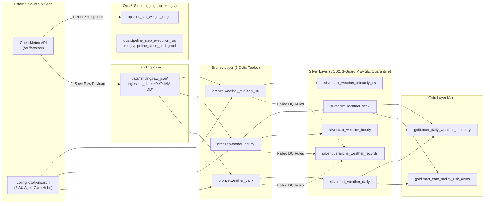

# Loop IQ — Open-Meteo Medallion Lakehouse Pipeline

An end-to-end, production-grade **Medallion Lakehouse data pipeline** built with **Python, PySpark, Delta Lake, DuckDB, and Streamlit**, designed for **Loop IQ's Australian Aged Care Environmental & Thermal Risk Monitoring** use case.

---

## 1. Key Engineering Highlights
* **`.env`-First Configuration (`pydantic-settings`):** Every runtime parameter—API endpoints, rate-limit budgets, batch sizes, weather variables, Delta paths, DQ bounds, and clinical alert thresholds—is externalized to `.env` (`.env.example` included) and validated at startup in [settings.py](file:///d:/Personal/Jobs/2026/144%20Loop%20IQ/Assignment/src/config/settings.py).
* **Open-Meteo Rate-Limit Governance & Post-Consumption Ledger (`ops.api_call_weight_ledger`):**
  * Implements Open-Meteo's dynamic call weight formula with baseline floors:
    $$\text{Weight} = N_{\text{locations}} \times \max\left(1.0, \frac{N_{\text{days}}}{14.0}\right) \times \max\left(1.0, \frac{N_{\text{variables}}}{10.0}\right)$$
  * Enforces pre-flight rolling quota checks (600/min, 5,000/hr, 10,000/day) and writes to `ops.api_call_weight_ledger` **strictly after** receiving the HTTP response from the Open-Meteo server (`HTTP 200 OK` records `consumed_call_weight > 0`; `4xx/5xx` records `0.0` for auditability; offline cache reads or pre-flight failures record nothing).
* **Landing Zone + 3 Granular Bronze Tables (`minutely_15`, `hourly`, `daily`):**
  * Fetches all 8 Australian Aged Care regional hubs in **one batched HTTP GET request** with per-location local IANA timezones (`Australia/Sydney`, `Australia/Darwin`, `Australia/Perth`, etc.).
  * Saves the unmodified HTTP payload to `data/landing/raw_json/ingestion_date=YYYY-MM-DD/batch_<call_id>.json` and fans out into `bronze.weather_minutely_15`, `bronze.weather_hourly`, and `bronze.weather_daily` for independent grain lineage.
* **Silver Layer Depth (SCD Type 2, 13-Rule DQ Quarantine, 3-Guard Idempotent `MERGE`):**
  * **`silver.dim_location_scd2`:** Tracks monitored care hubs, calculates Haversine grid-snap distance (`grid_snap_distance_km`) between requested facility coordinates and Open-Meteo's snapped NWP model grid cell, and maintains full **SCD Type 2** version history (`effective_from_utc`, `effective_to_utc`, `is_current`).
  * **Two-Stage Data Quality Gate (`13 Rules` $\rightarrow$ `silver.quarantine_weather_records`):** Evaluates Stage-1 structural/array-parity rules (`DQ-STRUCT-001..003`) prior to array explosion and Stage-2 physical/domain rules (`DQ-KEY-001`, `DQ-PHY-001..007`, `DQ-LOGIC-001`, `DQ-DOM-001` including WMO code `97`) post-explosion.
  * **Three-Guard Idempotent `MERGE INTO` + Change Data Feed (`CDF`):**
    1. *Incremental Read:* Processes only the target `pipeline_run_id` batch so failed Bronze rows are quarantined once.
    2. *Source Deduplication:* `ROW_NUMBER() OVER (PARTITION BY <keys> ORDER BY api_ingested_at_utc DESC) = 1`.
    3. *Newer-Only & Value-Changed Update:* `WHEN MATCHED AND src.api_ingested_at_utc >= tgt.api_ingested_at_utc AND src.row_value_hash != tgt.row_value_hash THEN UPDATE`, preventing stale replays from overwriting newer forecasts and keeping Delta's Change Data Feed (`_change_data`) free of no-op updates.
* **Gold Layer Marts (Dynamic Facility-Local Horizon & Care Risk Alerting):**
  * Evaluates `is_forecast` and `data_horizon_type` (`PAST_MODELLED`, `TODAY_MIXED`, `FORWARD_FORECAST`) dynamically in Gold against each facility's local calendar date—keeping Silver free of time-variant boolean flags.
  * Generates actionable aged-care risk alerts (`NORMAL`, `WATCH`, `WARNING`, `CRITICAL`) with clinical care protocols in `gold.mart_care_facility_risk_alerts`.
* **Step-Level Audit Logging & Checkpoint Repair Runner:**
  * Logs every step (`STARTED`, `SUCCESS`, `FAILED`, `SKIPPED_ON_REPAIR`) to `logs/pipeline_steps_audit.jsonl` and `ops.pipeline_step_execution_log`. Running `python -m src.cli repair --run-id <run_id>` automatically skips succeeded steps (reusing the landed raw JSON without re-calling the Open-Meteo API) and resumes from the failed step.

---

## 2. Architecture & Documentation Links

* **[Data Dictionary (All 10 Tables with Explicit Field Origins & Examples)](file:///d:/Personal/Jobs/2026/144%20Loop%20IQ/Assignment/docs/data_dictionary.md)**
* **[Data Quality Checks & Quarantine Specification (13 Rules)](file:///d:/Personal/Jobs/2026/144%20Loop%20IQ/Assignment/docs/data_quality_checks.md)**
* **[Architecture Decision Records (ADRs & S3 Lifecycle Strategy)](file:///d:/Personal/Jobs/2026/144%20Loop%20IQ/Assignment/docs/architecture_decisions.md)**
* **[Reference AWS S3 Bucket Lifecycle Policy JSON](file:///d:/Personal/Jobs/2026/144%20Loop%20IQ/Assignment/config/s3_lifecycle_policy.json)**
* **[AI-Assisted Engineering Evidence](file:///d:/Personal/Jobs/2026/144%20Loop%20IQ/Assignment/docs/ai_evidence/README.md)**



---

## 3. Quickstart: Running Locally (Docker Compose)

> **Why Docker is Recommended:** PySpark 3.5 + Delta Lake 3.2 requires **Python 3.10–3.12** and **OpenJDK 17**. Our `Dockerfile` bundles `Python 3.11 + OpenJDK 17` and pre-warms all Delta Lake Spark Maven JARs during `docker build` so the pipeline runs identically on Windows, macOS, and Linux with zero host JVM setup.

### Step 1: Prepare `.env`
```bash
cp .env.example .env
```

### Step 2: Run the End-to-End Pipeline + Launch Streamlit Dashboard
```bash
docker compose up --build
```
* The `pipeline` container executes all 7 Medallion steps (`step_1_ingest_to_landing` $\rightarrow$ `step_7_silver_to_gold_marts`) and prints the verification table across all 10 Delta tables.
* Once the pipeline completes, the `dashboard` container serves the interactive Streamlit UI at **`http://localhost:8501`**.

### Step 3: Common CLI Commands (via Docker)
```bash
# Run only the 7-step ETL pipeline and verification summary:
docker compose run --rm pipeline python -m src.cli run-all

# Verify all 10 Delta tables and inspect top Gold facility risk alerts:
docker compose run --rm pipeline python -m src.cli verify

# Run an ad-hoc DuckDB SQL query against any Lakehouse Delta table:
docker compose run --rm pipeline python -m src.cli query --sql "SELECT location_id, observation_local_date, overall_risk_severity, primary_hazard_reason FROM mart_care_facility_risk_alerts WHERE overall_risk_severity != 'NORMAL' ORDER BY observation_local_date"

# Repair a failed pipeline run from its exact failed step (without re-calling the API):
docker compose run --rm pipeline python -m src.cli repair --run-id <PIPELINE_RUN_ID>

# Run the automated pytest suite (verifying API weights, 13 DQ rules, SCD2, 3-guard MERGE, Gold marts, and step repair):
docker compose run --rm pipeline pytest -v
```

### Alternative: Running Directly via Local Python `.venv` (No Docker Required)
Our Lakehouse engine supports both full PySpark (`pyspark + delta-spark`) and a zero-JVM native Rust/C++ Delta Lake + DuckDB engine (`deltalake + duckdb + pyarrow`), so you can also run the entire pipeline and test suite directly on Windows, macOS, or Linux without Docker:
```powershell
# Run the full 7-step pipeline:
python -m src.cli run-all

# Run the automated test suite:
pytest -v

# Launch the Streamlit dashboard at http://localhost:8501:
streamlit run src/dashboard/app.py
```

---

## 4. Data Archiving & AWS S3 Bucket Lifecycle Strategy

In a production deployment on AWS (`S3 + AWS Glue / Spark + Delta Lake`), storage lifecycle management must distinguish between **standalone Raw JSON files** in the Landing Zone and **transaction-log-managed Parquet files** in active Delta Lake tables (see [s3_lifecycle_policy.json](file:///d:/Personal/Jobs/2026/144%20Loop%20IQ/Assignment/config/s3_lifecycle_policy.json)):

1. **Landing Zone Raw JSON (`s3://<bucket>/landing/raw_json/`):**
   * **Days 0–30 (`S3 Standard` — Hot):** Millisecond access for immediate operational repair runs and debugging.
   * **Days 31–90 (`S3 Glacier Instant Retrieval` — Warm):** Low-cost warm storage for monthly backfills.
   * **Days 91–2,555 (`S3 Glacier Deep Archive` — Cold):** $\sim 95\%$ storage cost reduction for 7-year aged-care regulatory audit compliance.
   * **Day 2,556+ (`Expiration` — Delete):** Automatic permanent deletion via S3 Lifecycle rule after the 7-year compliance window expires.
2. **Active Delta Lake Tables (`s3://<bucket>/lakehouse/{ops,bronze,silver,gold}/`):**
   * **Why Raw S3 Expiration Must Not Target Active Delta Prefixes:** An unchanged row in `silver.dim_location_scd2` may reside in a Parquet file that is 400+ days old while still being actively referenced by the current `_delta_log` snapshot. Deleting or moving that file to asynchronous Glacier via raw S3 age rules would corrupt the Delta table (`FileNotFoundException`).
   * **Proper Lakehouse Archiving:**
     * Apply **`S3 Intelligent-Tiering`** across `lakehouse/` so cold Parquet files automatically tier down to Infrequent Access (30d) and Archive Instant Access (90d) while preserving synchronous millisecond reads for Spark.
     * Run scheduled `VACUUM <table> RETAIN 168 HOURS` jobs to tombstone unreferenced Parquet files from `MERGE`/`OPTIMIZE` operations, paired with an S3 `NoncurrentVersionExpiration` rule (`14 days`) to permanently purge vacuumed object versions.
     * Offload historical fact partitions older than 2 years to `s3://<bucket>/archive/lakehouse/`, where S3 `DEEP_ARCHIVE` and `Expiration` at Day 2,555 safely apply.

# open_meteo_weather_monitoring_for_aged_care_hubs
In this repo, I have architected a pipelines to extract weather data from open meteo API and correlate with hypothetical aged care hubs around Australia. It will report any adverse weather expected for these hubs in coming days using this data and rules defined in the config file.
