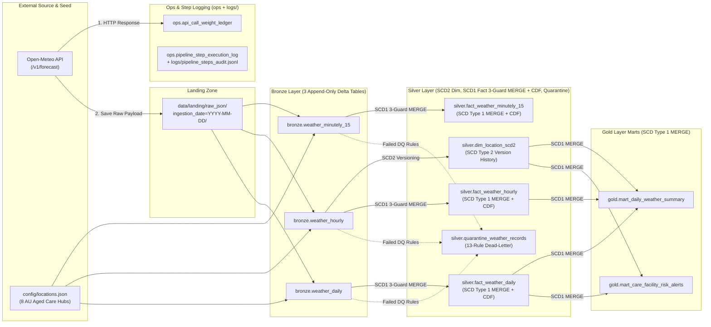

# Loop IQ — Open-Meteo Medallion Lakehouse Pipeline

An end-to-end, production-grade **Medallion Lakehouse data pipeline** built with **Python, PySpark, Delta Lake, DuckDB, and Streamlit**, designed for **Loop IQ's Australian Aged Care Environmental & Thermal Risk Monitoring** use case.

---

## 1. Key Engineering Highlights
* **`.env`-First Configuration (`pydantic-settings`):** Every runtime parameter—API endpoints, rate-limit budgets, batch sizes, weather variables, Delta paths, DQ bounds, and clinical alert thresholds—is externalized to `.env` (`.env.example` included) and validated at startup in [settings.py](file:///d:/Personal/Jobs/2026/144%20Loop%20IQ/Assignment/src/config/settings.py).
* **Open-Meteo Rate-Limit Governance & Post-Consumption Ledger (`ops.api_call_weight_ledger`):**
  * Implements Open-Meteo's dynamic call weight formula with baseline floors:
    $$\text{Weight} = N_{\text{locations}} \times \max\left(1.0, \frac{N_{\text{days}}}{14.0}\right) \times \max\left(1.0, \frac{N_{\text{variables}}}{10.0}\right)$$
  * Enforces pre-flight rolling quota checks (600/min, 5,000/hr, 10,000/day) and writes to `ops.api_call_weight_ledger` **strictly after** receiving the HTTP response from the Open-Meteo server (`HTTP 200 OK` records `consumed_call_weight > 0`; `4xx/5xx` records `0.0` for auditability; offline cache reads or pre-flight failures record nothing).
* **Landing Zone + 3 Granular Bronze Tables (`minutely_15`, `hourly`, `daily`):**
  * Fetches all 8 Australian Aged Care regional hubs in **one batched HTTP GET request** with per-location local IANA timezones (`Australia/Sydney`, `Australia/Darwin`, `Australia/Perth`, etc.).
  * Saves the unmodified HTTP payload to `data/landing/raw_json/ingestion_date=YYYY-MM-DD/batch_<call_id>.json` and fans out into `bronze.weather_minutely_15`, `bronze.weather_hourly`, and `bronze.weather_daily` for independent grain lineage.
* **Silver Layer Depth (SCD Type 2 Dimension, SCD Type 1 Fact `MERGE` Upserts + CDF, 13-Rule DQ Quarantine):**
  * **`silver.dim_location_scd2` (SCD Type 2):** Tracks monitored care hubs, calculates Haversine grid-snap distance (`grid_snap_distance_km`) between requested facility coordinates and Open-Meteo's snapped NWP model grid cell, and maintains full **SCD Type 2** version history (`effective_from_utc`, `effective_to_utc`, `is_current`).
  * **`silver.fact_weather_minutely_15`, `silver.fact_weather_hourly`, `silver.fact_weather_daily` (SCD Type 1 Upsert via Three-Guard `MERGE INTO` + Change Data Feed):**
    * Manages the sliding 14-day API window (`past_days=7` + `forecast_days=7`) using **SCD Type 1** in-place upserts on the natural key (`(location_id, observation_local_time)` or `(location_id, observation_local_date)`):
      * **Overlapping Window (Forecast Revisions & Forecast $\rightarrow$ Actuals):** When a newer API run revises a future forecast or replaces yesterday's forecast with past-modelled actuals, **SCD Type 1 `WHEN MATCHED THEN UPDATE`** overwrites the row in-place so downstream Gold queries always see a single authoritative value per timestamp without duplicate rows, while **Delta Change Data Feed (`delta.enableChangeDataFeed = true`)** and Delta Time Travel preserve prior forecast revisions in `_change_data` / `_delta_log`.
      * **New Future Window:** New dates/timestamps entering the 7-day forward horizon are appended via **`WHEN NOT MATCHED THEN INSERT`**.
      * **Historical Accumulation (>7 Days Ago):** Records older than `past_days=7` are untouched by the `MERGE`, so the Silver fact tables continuously accumulate permanent historical weather history over time.
    * **Three Idempotency Guards:**
      1. *Incremental Read:* Processes only the target `pipeline_run_id` batch so failed Bronze rows are quarantined once.
      2. *Source Deduplication:* `ROW_NUMBER() OVER (PARTITION BY <keys> ORDER BY api_ingested_at_utc DESC) = 1`.
      3. *Newer-Only & Value-Changed Update:* `WHEN MATCHED AND src.api_ingested_at_utc >= tgt.api_ingested_at_utc AND src.row_value_hash != tgt.row_value_hash THEN UPDATE`, preventing stale replays from overwriting newer forecasts and keeping Delta's Change Data Feed (`_change_data`) free of no-op updates.
  * **Two-Stage Data Quality Gate (`13 Rules` $\rightarrow$ `silver.quarantine_weather_records`):** Evaluates Stage-1 structural/array-parity rules (`DQ-STRUCT-001..003`) prior to array explosion and Stage-2 physical/domain rules (`DQ-KEY-001`, `DQ-PHY-001..007`, `DQ-LOGIC-001`, `DQ-DOM-001` including WMO code `97`) post-explosion.
* **Gold Layer Marts (Dynamic Facility-Local Horizon & Care Risk Alerting):**
  * Evaluates `is_forecast` and `data_horizon_type` (`PAST_MODELLED`, `TODAY_MIXED`, `FORWARD_FORECAST`) dynamically in Gold against each facility's local calendar date—keeping Silver free of time-variant boolean flags.
  * Generates actionable aged-care risk alerts (`NORMAL`, `WATCH`, `WARNING`, `CRITICAL`) with clinical care protocols in `gold.mart_care_facility_risk_alerts`.
* **Step-Level Audit Logging, Checkpoint Repair Runner & 7-Step Run Email Notifications:**
  * Logs every step (`STARTED`, `SUCCESS`, `FAILED`, `SKIPPED_ON_REPAIR`) to `logs/pipeline_steps_audit.jsonl` and `ops.pipeline_step_execution_log`. Running `python -m src.cli repair --run-id <run_id>` automatically skips succeeded steps (reusing the landed raw JSON without re-calling the Open-Meteo API) and resumes from the failed step.
  * Automatically generates a **7-Step HTML + Plain-Text Run Report** (`logs/emails/email_<run_id>.html`) after every run (`SUCCESS` or `FAILED` via [email_notifier.py](file:///d:/Personal/Jobs/2026/144%20Loop%20IQ/Assignment/src/utils/email_notifier.py)) and dispatches it via SMTP when `ALERT_EMAIL_ENABLED=true` in `.env`.

---

## 2. Architecture & Documentation Links

* **[Data Dictionary (All 10 Tables with Explicit Field Origins & Examples)](file:///d:/Personal/Jobs/2026/144%20Loop%20IQ/Assignment/docs/data_dictionary.md)**
* **[Data Quality Checks & Quarantine Specification (13 Rules)](file:///d:/Personal/Jobs/2026/144%20Loop%20IQ/Assignment/docs/data_quality_checks.md)**
* **[Architecture Decision Records (ADRs & S3 Lifecycle Strategy)](file:///d:/Personal/Jobs/2026/144%20Loop%20IQ/Assignment/docs/architecture_decisions.md)**
* **[Reference AWS S3 Bucket Lifecycle Policy JSON](file:///d:/Personal/Jobs/2026/144%20Loop%20IQ/Assignment/config/s3_lifecycle_policy.json)**
* **[AI-Assisted Engineering Evidence](file:///d:/Personal/Jobs/2026/144%20Loop%20IQ/Assignment/docs/ai_evidence/README.md)**



---

## 3. Quickstart: Running Locally (Docker Compose)

> **Why Docker is Recommended:** PySpark 3.5 + Delta Lake 3.2 requires **Python 3.10–3.12** and **OpenJDK 17**. Our `Dockerfile` bundles `Python 3.11 + OpenJDK 17` and pre-warms all Delta Lake Spark Maven JARs during `docker build` so the pipeline runs identically on Windows, macOS, and Linux with zero host JVM setup.

### Step 1: Prepare `.env`
```bash
cp .env.example .env
```

### Step 2: Run the End-to-End Pipeline + Launch Streamlit Dashboard
```bash
docker compose up --build
```
* The `pipeline` container executes all 7 Medallion steps (`step_1_ingest_to_landing` $\rightarrow$ `step_7_silver_to_gold_marts`) and prints the verification table across all 10 Delta tables.
* Once the pipeline completes, the `dashboard` container serves the interactive Streamlit UI at **`http://localhost:8501`**.

### Step 3: Common CLI Commands (via Docker)
```bash
# Run only the 7-step ETL pipeline and verification summary:
docker compose run --rm pipeline python -m src.cli run-all

# Verify all 10 Delta tables and inspect top Gold facility risk alerts:
docker compose run --rm pipeline python -m src.cli verify

# Run an ad-hoc DuckDB SQL query against any Lakehouse Delta table:
docker compose run --rm pipeline python -m src.cli query --sql "SELECT location_id, observation_local_date, overall_risk_severity, primary_hazard_reason FROM mart_care_facility_risk_alerts WHERE overall_risk_severity != 'NORMAL' ORDER BY observation_local_date"

# Repair a failed pipeline run from its exact failed step (without re-calling the API):
docker compose run --rm pipeline python -m src.cli repair --run-id <PIPELINE_RUN_ID>

# Run the automated pytest suite (verifying API weights, 13 DQ rules, SCD2, 3-guard MERGE, Gold marts, and step repair):
docker compose run --rm pipeline pytest -v
```

### Alternative: Running Directly via Local Python `.venv` (No Docker Required)
Our Lakehouse engine supports both full PySpark (`pyspark + delta-spark`) and a zero-JVM native Rust/C++ Delta Lake + DuckDB engine (`deltalake + duckdb + pyarrow`), so a teammate or reviewer can also run the entire pipeline and test suite directly on Windows, macOS, or Linux without Docker.

Because `.venv/` is git-ignored, first create the virtual environment and install dependencies from `requirements.txt`:

**On Windows (PowerShell):**
```powershell
# 1. Create and activate the virtual environment, then install packages:
python -m venv .venv
.\.venv\Scripts\Activate.ps1
pip install -r requirements.txt

# 2. Copy the environment configuration:
Copy-Item .env.example .env

# 3. Run the full 7-step pipeline:
python -m src.cli run-all

# 4. Run the automated test suite:
pytest -v

# 5. Launch the Streamlit dashboard (including the DuckDB SQL Workbench) at http://localhost:8501:
streamlit run src/dashboard/app.py
```

**On macOS / Linux (Bash / Zsh):**
```bash
python3 -m venv .venv
source .venv/bin/activate
pip install -r requirements.txt
cp .env.example .env
python -m src.cli run-all
pytest -v
streamlit run src/dashboard/app.py
```

### Automated Test Suite Overview (`tests/` — 10 Tests)
Running `pytest -v` executes 10 automated unit and integration tests inside isolated temporary directories (`tmp_path`, so your live `./data/` folder is never modified). Each test file validates a core architectural requirement:

| Test File | What It Tests & Proves |
| :--- | :--- |
| **[`tests/test_api_weight_and_ledger.py`](file:///d:/Personal/Jobs/2026/144%20Loop%20IQ/Assignment/tests/test_api_weight_and_ledger.py)** | **1. Call Weight Math:** Verifies `max(1.0, nDays/14) * max(1.0, nVars/10)` floor behavior and `16.8` weight for our 8-hub batch.<br/>**2. Payload Normalization:** Verifies single-location `dict` vs. multi-location `list` JSON handling.<br/>**3. Post-Consumption Ledger:** Proves `HTTP 200` logs `consumed_call_weight > 0`, `HTTP 429/500` logs `0.0`, and pre-flight rate-limit breaches abort before making an HTTP call. |
| **[`tests/test_dq_and_quarantine.py`](file:///d:/Personal/Jobs/2026/144%20Loop%20IQ/Assignment/tests/test_dq_and_quarantine.py)** | **Stage 1 & Stage 2 DQ Gate (13 Rules):** Injects corrupted records (array length mismatch `DQ-STRUCT-003`, out-of-range temperature `145°C`, `temp_max < temp_min` `DQ-LOGIC-001`, invalid WMO code `999` `DQ-DOM-001`) and verifies they are routed to `silver.quarantine_weather_records` while valid rows (including WMO code `97`) pass cleanly into Silver. |
| **[`tests/test_silver_scd2_and_facts.py`](file:///d:/Personal/Jobs/2026/144%20Loop%20IQ/Assignment/tests/test_silver_scd2_and_facts.py)** | **1. Time Semantics:** Verifies `observation_local_time` + `utc_offset_seconds` conversion to true `observation_time_utc`.<br/>**2. SCD Type 2 Rollover:** Updates a care hub's `climate_risk_tier` (`STANDARD` $\rightarrow$ `HIGH_HEAT`) and verifies the prior version is expired (`is_current = False`) and a new version is inserted (`is_current = True`).<br/>**3. SCD Type 1 (3-Guard Idempotent `MERGE`):** Replays the same batch and verifies zero duplicate rows and zero no-op updates. |
| **[`tests/test_gold_marts.py`](file:///d:/Personal/Jobs/2026/144%20Loop%20IQ/Assignment/tests/test_gold_marts.py)** | **Gold Marts & Dynamic Horizon:** Verifies local-date classification (`PAST_MODELLED`, `TODAY_MIXED`, `FORWARD_FORECAST`), 7-day rolling averages, and aged-care risk severity triggers (`CRITICAL`, `WARNING`, `WATCH`, `NORMAL`). |
| **[`tests/test_step_repair.py`](file:///d:/Personal/Jobs/2026/144%20Loop%20IQ/Assignment/tests/test_step_repair.py)** | **Step Audit & Checkpoint Repair:** Simulates a pipeline crash at `step_4_landing_to_bronze_daily`, verifies `FAILED` is logged, then runs `repair` and proves Steps 1–3 are marked `SKIPPED_ON_REPAIR` (without re-calling the Open-Meteo API) while Steps 4–7 complete to `SUCCESS`. |
| **[`tests/test_email_notifier.py`](file:///d:/Personal/Jobs/2026/144%20Loop%20IQ/Assignment/tests/test_email_notifier.py)** | **7-Step Email Alerting:** Verifies that a failure at Step 3 renders all 7 steps in the HTML/text email (`1–2 SUCCESS`, `3 FAILED` with traceback + repair command, `4–7 NOT_RUN`) and tests SMTP dispatch via mock `smtplib.SMTP`. |

---

## 4. Data Archiving & AWS S3 Bucket Lifecycle Strategy

In a production deployment on AWS (`S3 + AWS Glue / Spark + Delta Lake`), storage lifecycle management must distinguish between **standalone Raw JSON files** in the Landing Zone and **transaction-log-managed Parquet files** in active Delta Lake tables (see [s3_lifecycle_policy.json](file:///d:/Personal/Jobs/2026/144%20Loop%20IQ/Assignment/config/s3_lifecycle_policy.json)):

1. **Landing Zone Raw JSON (`s3://<bucket>/landing/raw_json/`):**
   * **Days 0–30 (`S3 Standard` — Hot):** Millisecond access for immediate operational repair runs and debugging.
   * **Days 31–90 (`S3 Glacier Instant Retrieval` — Warm):** Low-cost warm storage for monthly backfills.
   * **Days 91–2,555 (`S3 Glacier Deep Archive` — Cold):** $\sim 95\%$ storage cost reduction for 7-year aged-care regulatory audit compliance.
   * **Day 2,556+ (`Expiration` — Delete):** Automatic permanent deletion via S3 Lifecycle rule after the 7-year compliance window expires.
2. **Active Delta Lake Tables (`s3://<bucket>/lakehouse/{ops,bronze,silver,gold}/`):**
   * **Why Raw S3 Expiration Must Not Target Active Delta Prefixes:** An unchanged row in `silver.dim_location_scd2` may reside in a Parquet file that is 400+ days old while still being actively referenced by the current `_delta_log` snapshot. Deleting or moving that file to asynchronous Glacier via raw S3 age rules would corrupt the Delta table (`FileNotFoundException`).
   * **Proper Lakehouse Archiving:**
     * Apply **`S3 Intelligent-Tiering`** across `lakehouse/` so cold Parquet files automatically tier down to Infrequent Access (30d) and Archive Instant Access (90d) while preserving synchronous millisecond reads for Spark.
     * Run scheduled `VACUUM <table> RETAIN 168 HOURS` jobs to tombstone unreferenced Parquet files from `MERGE`/`OPTIMIZE` operations, paired with an S3 `NoncurrentVersionExpiration` rule (`14 days`) to permanently purge vacuumed object versions.
     * Offload historical fact partitions older than 2 years to `s3://<bucket>/archive/lakehouse/`, where S3 `DEEP_ARCHIVE` and `Expiration` at Day 2,555 safely apply.

---

## 5. Future Improvements & Production Roadmap

1. **Hourly Exposure Duration & Peak-Hour Escalation in `gold.mart_care_facility_risk_alerts`:**
   * **Current v1 Design Rationale:** In the current implementation, `gold.mart_care_facility_risk_alerts` evaluates daily extremes from `silver.fact_weather_daily` (`temp_max_c`, `temp_min_c`, `apparent_temp_max_c`, `wind_speed_max_kmh`, `uv_index_max`, and worst-case daily `weather_code`). Because Open-Meteo computes `daily` variables over each facility's local 24-hour day (`ADR-002`), those fields already capture the exact 24-hour worst-case peaks while keeping the alerting rules simple, deterministic, and aligned with daily nursing shift planning.
   * **Phase 2 Enhancement (Joining `silver.fact_weather_hourly` for Persistence & Timing):** Two days can share the exact same daily maximum temperature (e.g., `temp_max_c = 36.0°C`) while posing very different clinical risks:
     * *Day A (Brief Spike):* Crosses $35^\circ\text{C}$ for only **1 hour** at `14:00` before a coastal cool change drops temperatures to $23^\circ\text{C}$.
     * *Day B (Sustained Heatwave):* Remains above $35^\circ\text{C}$ for **8 consecutive hours** (`11:00–18:00`) with warm overnight minimums that prevent passive building cooling.
   * **Planned Calculation:** Roll up `silver.fact_weather_hourly` by `(location_id, observation_local_date)` to compute `heat_risk_hours_count` (`SUM(CASE WHEN temperature_2m_c >= 35.0 THEN 1 ELSE 0 END)`), `cold_risk_hours_count`, and the exact local clock hour of peak risk (`ARG_MAX(SUBSTRING(observation_local_time, 12, 5), temperature_2m_c)`), then join into `gold.mart_care_facility_risk_alerts` so short $1\text{--}3\text{ hour}$ spikes trigger a targeted **`WARNING`** while sustained $\ge 4\text{ hour}$ exposures automatically escalate to **`CRITICAL`**.
2. **True Weather-Station Gauge Reconciliation (BOM AWS Observations):**
   * Integrate physical Bureau of Meteorology (BOM) Automatic Weather Station (AWS) observations alongside Open-Meteo's NWP model reanalysis (`past_days=7`) to quantify forecast bias per care hub using Delta Lake's Change Data Feed (`_change_data`).
3. **Automated Alert Dispatch (Webhook / PagerDuty / MS Teams):**
   * Trigger outbound notifications for `CRITICAL` and `WARNING` rows in `gold.mart_care_facility_risk_alerts` where `data_horizon_type IN ('TODAY_MIXED', 'FORWARD_FORECAST')`.

# open_meteo_weather_monitoring_for_aged_care_hubs
In this repo, I have architected a pipelines to extract weather data from open meteo API and correlate with hypothetical aged care hubs around Australia. It will report any adverse weather expected for these hubs in coming days using this data and rules defined in the config file.
