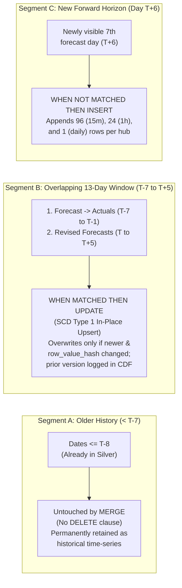

# Architecture Decision Records (ADRs)

## ADR-001: Landing Zone + 3 Granular Bronze Tables (`minutely_15`, `hourly`, `daily`)
* **Context:** Open-Meteo `/v1/forecast` can return `minutely_15`, `hourly`, and `daily` time-series blocks in a single HTTP response. However, `minutely_15` produces $96\times$ as many timestamps per day as `daily`.
* **Decision:**
  1. Persist the unmodified multi-location HTTP response JSON in an immutable **Landing Zone** (`data/landing/raw_json/ingestion_date=YYYY-MM-DD/batch_<call_id>.json`).
  2. Split the landed payload into **three grain-specific Bronze Delta tables**: `bronze.weather_minutely_15`, `bronze.weather_hourly`, and `bronze.weather_daily`.
* **Consequences:** Single network round-trip per batch, full raw file auditability for cold S3 archival, and independent lineage/replay per temporal resolution without scanning bloated 15-minute arrays during hourly/daily backfills.

---

## ADR-002: Per-Location Local Timezones + `utc_offset_seconds` (Time Semantics)
* **Context:** Open-Meteo computes `daily` aggregations (`temperature_2m_max`, `temperature_2m_min`, `precipitation_sum`) over the 24-hour calendar day of whatever `timezone` parameter is passed in the query. If `timezone=UTC` is requested for Australian care hubs, a "day" in Sydney (`UTC+11`) runs from 11:00 AM to 11:00 AM local time, corrupting daily heatwave alerts and misaligning hourly-to-daily joins across Perth (`+8`), Darwin (`+9:30`), and Sydney (`+11`).
* **Decision:**
  1. Request each facility's local IANA timezone (`timezone=Australia/Sydney,Australia/Melbourne,...`) in the batched API request.
  2. Capture `utc_offset_seconds` from the top-level API JSON response in all 3 Bronze tables.
  3. In Silver (`fact_weather_minutely_15`, `fact_weather_hourly`), store **both** `observation_local_time` / `observation_local_date` (the facility's true local calendar date) and true `observation_time_utc` (`observation_local_time - utc_offset_seconds`).
  4. Join `hourly` and `daily` in Gold on `(location_id, observation_local_date)`.

---

## ADR-003: Hybrid Dimensional Strategy — SCD Type 2 for Locations vs. SCD Type 1 (`3-Guard MERGE` + CDF) for Sliding 14-Day Weather Facts

### 1. Context & Architectural Trade-Off (SCD2 vs. SCD1 + CDF)
Every pipeline execution on Run Day $T$ fetches a **sliding 14-day window** (`past_days=7` + `forecast_days=7`, covering local dates $[T-7, T+6]$) across 8 care hubs:
* **`silver.dim_location_scd2` (SCD Type 2):** Facility metadata (`climate_risk_tier`, `location_name`, snapped grid coordinates) is low-cardinality (`8` hubs) and changes infrequently (e.g., after an annual clinical risk audit). **SCD Type 2** (`effective_from_utc`, `effective_to_utc`, `is_current`) is ideal here so historical changes to a facility's risk tier are preserved as explicit dimension rows.
* **`silver.fact_weather_minutely_15`, `silver.fact_weather_hourly`, `silver.fact_weather_daily` (SCD Type 1 Upsert + Delta Change Data Feed):**
  * **Why NOT SCD Type 2 on Weather Facts:** Because each daily API call re-fetches a 14-day window (`10,752` 15-minute rows + `2,688` hourly rows + `112` daily rows per run), modeling weather facts as SCD Type 2 would create up to **14 duplicate version rows per timestamp**, inflating table volume by $14\times$ and forcing every downstream Gold aggregation and window function (`AVG(...) OVER (ROWS BETWEEN 6 PRECEDING AND CURRENT ROW)`) to filter `WHERE is_current = true`.
  * **Why SCD Type 1 + Bronze Lineage & Delta Change Data Feed (`CDF`) Wins:** Using **SCD Type 1 (`MERGE INTO`)** on the natural grain (`(location_id, observation_time_utc)` or `(location_id, observation_local_date)`) guarantees **strictly one authoritative row per facility per timestamp** in the active Silver tables. Meanwhile, our **append-only Bronze tables (`bronze.weather_*`)** serve as the primary queryable historical archive of every prior forecast batch across runs, and **`delta.enableChangeDataFeed = true`** + Delta Time Travel (`_delta_log`) are enabled on all Silver and Gold Delta tables to track in-place row updates.
  * **Freshness Monitoring Note (`updated_at_utc`):** Because Guard 3 (`src.row_value_hash != tgt.row_value_hash`) intentionally skips no-op updates when forecast values have not changed between runs, `silver.fact_weather_*.updated_at_utc` reflects the timestamp of the last **value change** rather than the last pipeline execution. Pipeline execution freshness should be monitored via `ops.pipeline_step_execution_log.logged_at_utc` or `gold.*.mart_updated_at_utc` / `evaluated_at_utc`.

### 2. Sliding 14-Day Window Lifecycle Across Consecutive Runs
When the pipeline runs on **Day $T$** (after having previously run on Day $T-1$, which loaded $[T-8, T+5]$), the SCD Type 1 `MERGE INTO` handles the timeline in three distinct segments:



| Timeline Segment (Run on Day $T$) | Date Range | What Changed in the API? | SCD Type 1 `MERGE INTO` Action in Silver | Downstream Impact |
| :--- | :--- | :--- | :--- | :--- |
| **Segment A: Older History** | $< T-7$ (e.g., $\le T-8$) | Outside the current `past_days=7` API request window; no longer returned by today's API call. | **Untouched (Retained Permanently):** Because our `MERGE` intentionally omits `WHEN NOT MATCHED BY SOURCE THEN DELETE`, rows older than 7 days remain intact in Silver. | Over weeks and months, Silver automatically accumulates a continuous, multi-year historical weather archive. |
| **Segment B: Overlapping Window** | $[T-7, T+5]$ (13 overlapping days) | **1. Forecast $\rightarrow$ Actuals:** Yesterday's forecast for $T-1$ is now assimilated past-modelled history.<br/>**2. Forecast Revisions:** Forecasts for $[T, T+5]$ are updated with the latest NWP model run. | **`WHEN MATCHED` (SCD Type 1 Update):** Overwrites the existing row in-place **only** if `src.api_ingested_at_utc >= tgt.api_ingested_at_utc` **and** `src.row_value_hash != tgt.row_value_hash`. | Gold queries see the latest authoritative measurement/forecast per timestamp without duplicates; prior forecast revisions remain queryable via Delta CDF (`_change_data`). |
| **Segment C: New Horizon** | $T+6$ (1 new future day) | Newly entered 7th forward forecast day that was not in yesterday's $[T-8, T+5]$ window. | **`WHEN NOT MATCHED THEN INSERT`:** Appends `96` 15-minute rows, `24` hourly rows, and `1` daily row per care hub. | Extends the forward alerting horizon by 24 hours. |

### 3. Three Idempotency Guards on Every Silver SCD Type 1 `MERGE`
To ensure that re-running or repairing a pipeline batch is 100% idempotent, every Silver fact `MERGE` enforces three guards:
1. **Guard 1 (Incremental Parquet Predicate Pushdown):** Filter Bronze via `DeltaTable(path).to_pyarrow_table(filters=[("pipeline_run_id", "=", pipeline_run_id)])` so only the active batch is read and failed rows are evaluated once per batch.
2. **Guard 2 (Source Deduplication):** Deduplicate candidate rows on primary key ordered by `api_ingested_at_utc` ascending (retaining the latest `api_ingested_at_utc` per key).
3. **Guard 3 (Newer-Only & Value-Changed Update):**
   ```sql
   WHEN MATCHED AND src.api_ingested_at_utc >= tgt.api_ingested_at_utc
                AND src.row_value_hash != tgt.row_value_hash
   THEN UPDATE SET *
   ```
   This prevents out-of-order replays of older landed files from overwriting newer forecasts and prevents unchanged rows in Segment B from generating noisy no-op commits in the Delta log.

---

## ADR-004: Dynamic Horizon Evaluation (`PAST_MODELLED` / `TODAY_MIXED` / `FORWARD_FORECAST`) in Gold Only
* **Context:** Storing a boolean `is_forecast` column in Silver is a time-variant anti-pattern: tomorrow's forecast (`is_forecast = true` today) becomes yesterday's history two days later, requiring constant rewrites of historical Silver partitions. Furthermore, Open-Meteo `/v1/forecast` with `past_days=7` provides archived model analysis/hindcast grids rather than physical weather-station gauge observations.
* **Decision:** Keep Silver purely time-series invariant (no `is_forecast` column). Evaluate `is_forecast` and the 3-state `data_horizon_type` (`PAST_MODELLED`, `TODAY_MIXED`, `FORWARD_FORECAST`) dynamically in the **Gold Layer** against each facility's local calendar date (`now_utc.astimezone(ZoneInfo(timezone_name)).date()`).

---

## ADR-005: Open-Meteo `minutely_15` Interpolation Nuance in Australia
* **Context:** High-resolution native 15-minute NWP models on Open-Meteo (DWD ICON-D2, NOAA HRRR) cover Central Europe and North America. For Australia (covered by BOM ACCESS-G and ECMWF IFS), Open-Meteo returns `minutely_15` arrays by linearly interpolating 1-hour model grids (and dividing hourly precipitation by 4, rounded to `0.1 mm`).
* **Decision:** Ingest and validate `bronze.weather_minutely_15` $\rightarrow$ `silver.fact_weather_minutely_15` for sub-hourly pipeline lineage completeness, while grounding Gold daily averages, rolling 7-day baselines, and clinical risk alerts strictly on native `hourly` and `daily` series.

---

## ADR-006: Data Archiving & AWS S3 Bucket Lifecycle Policies
* **Context:** In production on AWS (S3 + Glue/Spark + Delta Lake), aged-care compliance requires up to 7 years (`2,555` days) of audit retention, while cloud storage costs must be minimized.
* **Decision:** Reference policy defined in [s3_lifecycle_policy.json](../config/s3_lifecycle_policy.json):
  * **Landing Raw JSON (`landing/raw_json/`):** Standalone immutable files transition from `S3 Standard` (Days 0–30) $\rightarrow$ `S3 Glacier Instant Retrieval` (Days 31–90) $\rightarrow$ `S3 Glacier Deep Archive` (Days 91–2,555) $\rightarrow$ Permanent `Expiration` (Delete at Day 2,556).
  * **Active Delta Lake Tables (`lakehouse/`):** Never apply raw object age expiration directly to active Delta prefixes (which would delete unchanged `dim_location_scd2` Parquet files still referenced by `_delta_log`!). Instead, apply **`S3 Intelligent-Tiering`** on active files + scheduled **`DELTA VACUUM RETAIN 168 HOURS`** + S3 `NoncurrentVersionExpiration` (14 days) to purge tombstoned files safely.
