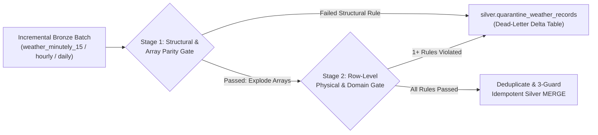

# Data Quality (DQ) Checks & Quarantine Specification

## 1. Objective & Architecture
In a regulated analytics environment like Loop IQ, bad or anomalous upstream data must **never** silently corrupt Silver or Gold tables, nor should a single malformed row crash an entire multi-location pipeline run without diagnostic visibility.

Our pipeline implements a **two-stage Data Quality gate** at the **Bronze $\rightarrow$ Silver** boundary (`src/quality/validators.py`).
* **Incremental Evaluation Guard:** Each Silver transformation run filters Bronze inputs to the active `pipeline_run_id` (or `ingested_at_utc > last_processed_watermark`). This guarantees that a malformed Bronze record is evaluated and quarantined **once**, rather than being re-scanned and re-quarantined on every future pipeline run.
* **Dead-Letter Routing:** Any record failing one or more rules is diverted to **`silver.quarantine_weather_records`** with full diagnostic metadata (`dq_rule_violated`, `dq_failure_details`, `failed_record_json`, `source_ingestion_id`, `source_bronze_table`) while valid records proceed to the 3-guard idempotent `MERGE INTO` on the target Silver tables.

---

## 2. Complete Data Quality Rule Registry (13 Rules)

Every rule below has a deterministic `rule_id`. If a record violates multiple rules simultaneously (e.g., both temperature and humidity are out of physical bounds), all triggered `rule_id` codes are concatenated into `silver.quarantine_weather_records.dq_rule_violated` (e.g., `"DQ-PHY-001,DQ-PHY-002"`).

### 2.1 Stage 1: Structural & Array Integrity Rules (Pre-Explosion)
Evaluated on each Bronze row (`bronze.weather_minutely_15`, `bronze.weather_hourly`, `bronze.weather_daily`) **before** unnesting parallel arrays.

| Rule ID | Rule Name | Target Bronze Input | Validation Logic / Predicate | Failure Action | Example Quarantined Condition |
| :--- | :--- | :--- | :--- | :--- | :--- |
| **`DQ-STRUCT-001`** | `NON_EMPTY_TIME_ARRAY` | `minutely_15`, `hourly`, `daily` | `isinstance(time_array, list) and len(time_array) > 0` | Route entire location batch row to `silver.quarantine_weather_records` | Open-Meteo returned `"hourly": {"time": []}` for a location. |
| **`DQ-STRUCT-002`** | `ARRAY_LENGTH_PARITY` | `minutely_15`, `hourly`, `daily` | Every metric array length must equal `len(time_array)` (e.g., `len(temperature_2m) == len(time)`) | Prevent parallel array index misalignment; route malformed payload to quarantine | `len(hourly.time) = 336` but `len(hourly.temperature_2m) = 335`. |
| **`DQ-STRUCT-003`** | `VALID_COORDINATE_AND_OFFSET` | All Bronze tables | `model_grid_latitude BETWEEN -90.0 AND 90.0 AND model_grid_longitude BETWEEN -180.0 AND 180.0 AND utc_offset_seconds BETWEEN -43200 AND 50400` (and none are `NULL`) | Route payload to quarantine | Corrupted JSON latitude `999.0` or missing (`NULL`) `utc_offset_seconds`. |

---

### 2.2 Stage 2: Row-Level Key, Physical & Domain Rules (Post-Explosion)
Evaluated on every unnested time-series row prior to upserting into `silver.fact_weather_minutely_15`, `silver.fact_weather_hourly`, and `silver.fact_weather_daily`. Threshold bounds are configurable via `.env` (`DQ_MIN_VALID_TEMP_C`, `DQ_MAX_VALID_TEMP_C`, etc.).

| Rule ID | Rule Name | Target Silver Table(s) | Column(s) Checked | Validation Logic / SQL Predicate | Why This Rule Matters | Example Violation |
| :--- | :--- | :--- | :--- | :--- | :--- | :--- |
| **`DQ-KEY-001`** | `NOT_NULL_PRIMARY_GRAIN` | `fact_weather_minutely_15`, `fact_weather_hourly`, `fact_weather_daily` | `location_id`, `observation_time_utc`, `observation_local_date` | `location_id IS NOT NULL AND trim(location_id) != '' AND observation_local_date IS NOT NULL` (plus `observation_time_utc IS NOT NULL` for sub-daily tables) | Delta `MERGE INTO` keys cannot be null or blank; prevents orphan time-series points. | `observation_time_utc = NULL` due to unparseable ISO8601 string. |
| **`DQ-PHY-001`** | `TEMP_PHYSICAL_BOUNDS` | `fact_weather_minutely_15`, `fact_weather_hourly`, `fact_weather_daily` | `temperature_2m_c`, `temp_max_c`, `temp_min_c` | `value IS NOT NULL AND value BETWEEN -50.0 AND 60.0` *(configurable via `.env`)* | Highest recorded temperature in Australia is $50.7^\circ\text{C}$ and lowest is $-23.0^\circ\text{C}$; values outside $[-50, 60]^\circ\text{C}$ indicate sensor/model corruption or Kelvin/Fahrenheit unit mismatch. | `temperature_2m_c = 295.15` (accidentally returned in Kelvin) or `NULL`. |
| **`DQ-PHY-002`** | `HUMIDITY_PERCENT_BOUNDS` | `fact_weather_hourly` | `relative_humidity_pct` | `relative_humidity_pct IS NULL OR (relative_humidity_pct >= 0.0 AND relative_humidity_pct <= 100.0)` | Relative humidity is physically bounded between $0\%$ and $100\%$. | `relative_humidity_pct = 108.5` or `-5.0`. |
| **`DQ-PHY-003`** | `NON_NEGATIVE_PRECIPITATION` | `fact_weather_minutely_15`, `fact_weather_hourly`, `fact_weather_daily` | `precipitation_mm`, `precipitation_sum_mm` | `value IS NULL OR (value >= 0.0 AND value <= 1000.0)` | Rainfall depth cannot be negative or exceed $1,000\text{ mm}$ in a single hour/day. | `precipitation_mm = -1.2`. |
| **`DQ-PHY-004`** | `PRECIP_PROBABILITY_BOUNDS` | `fact_weather_hourly` | `precipitation_prob_pct` | `precipitation_prob_pct IS NULL OR (precipitation_prob_pct >= 0.0 AND precipitation_prob_pct <= 100.0)` | Probability must be a valid percentage $[0, 100]$. | `precipitation_prob_pct = 120.0`. |
| **`DQ-PHY-005`** | `WIND_SPEED_BOUNDS` | `fact_weather_minutely_15`, `fact_weather_hourly`, `fact_weather_daily` | `wind_speed_10m_kmh`, `wind_speed_max_kmh` | `value IS NULL OR (value >= 0.0 AND value <= 400.0)` | Wind speed is a scalar magnitude ($\ge 0$) and cannot physically exceed $400\text{ km/h}$ (Category 5+ cyclone gust limit). | `wind_speed_10m_kmh = -15.0`. |
| **`DQ-PHY-006`** | `SURFACE_PRESSURE_BOUNDS` | `fact_weather_hourly` | `surface_pressure_hpa` | `surface_pressure_hpa IS NULL OR (surface_pressure_hpa BETWEEN 850.0 AND 1100.0)` | Sea-level/surface atmospheric pressure on Earth stays within $[850, 1100]\text{ hPa}$. | `surface_pressure_hpa = 0.0` or `2500.0`. |
| **`DQ-PHY-007`** | `UV_INDEX_BOUNDS` | `fact_weather_hourly`, `fact_weather_daily` | `uv_index`, `uv_index_max` | `value IS NULL OR (value >= 0.0 AND value <= 25.0)` | UV index cannot be negative or exceed extreme solar upper bound ($25.0$). | `uv_index = -2.0`. |
| **`DQ-LOGIC-001`** | `DAILY_MIN_LEQ_MAX_TEMP` | `fact_weather_daily` | `temp_min_c`, `temp_max_c` | `temp_min_c <= temp_max_c` | Daily minimum temperature cannot logically exceed the daily maximum temperature for the same location and local date. | `temp_min_c = 28.0` and `temp_max_c = 21.5`. |
| **`DQ-DOM-001`** | `VALID_WMO_WEATHER_CODE` | `fact_weather_minutely_15`, `fact_weather_hourly`, `fact_weather_daily` | `weather_code` | `weather_code IN (0,1,2,3,45,48,51,53,55,56,57,61,63,65,66,67,71,73,75,77,80,81,82,85,86,95,96,97,99)` | Ensures `weather_code` conforms to Open-Meteo's WMO 4677 interpretation codes (explicitly including **`97`** — *Heavy thunderstorm without hail*, which global models covering Australia emit instead of `96`/`99`). | `weather_code = 999` or `-1`. |

---

## 3. How Failed Rows Populate `silver.quarantine_weather_records`

When the Silver transformer (`src/transformation/silver_transformer.py`) runs:
1. **Stage 1 Check:** Each Bronze location row is checked against `DQ-STRUCT-001`, `DQ-STRUCT-002`, and `DQ-STRUCT-003`. Any failing Bronze payload is immediately formatted and routed to `silver.quarantine_weather_records`.
2. **Stage 2 Check:** Passing Bronze payloads have their parallel JSON arrays unnested into individual time-series records. Each unnested row is evaluated against all applicable Stage 2 predicates (`DQ-KEY-001`, `DQ-PHY-*`, `DQ-LOGIC-001`, `DQ-DOM-001`).
3. **Idempotent Quarantine Write (`len(rules) > 0`):** Invalid rows are written to `silver.quarantine_weather_records` (filtering out any existing `quarantine_id` so `repair` runs never create duplicate quarantine rows) with:
   * `quarantine_id`: Deterministic SHA-256 hash of `pipeline_run_id || source_ingestion_id || raw_time_str || dq_rule_violated`.
   * `pipeline_run_id`: Active pipeline run ID.
   * `source_bronze_table`: `"bronze.weather_minutely_15"`, `"bronze.weather_hourly"`, or `"bronze.weather_daily"`.
   * `source_ingestion_id`: Lineage link back to the exact Bronze record.
   * `target_silver_table`: `"silver.fact_weather_minutely_15"`, `"silver.fact_weather_hourly"`, or `"silver.fact_weather_daily"`.
   * `location_id`: e.g., `"AU-NSW-SYD-01"`.
   * `observation_timestamp_raw`: Raw local timestamp/date string from the API array (`time[k]`).
   * `failed_record_json`: Complete JSON serialization of the rejected row's values.
   * `dq_rule_violated`: Comma-separated string of violated Rule IDs (e.g., `"DQ-PHY-001,DQ-PHY-002"`).
   * `dq_failure_details`: Human-readable diagnostic explanation of the violated rules.
   * `quarantined_at_utc`: Current UTC timestamp.
